# StratSim: Strategy Under Fire (v2.0)
> **Interactive Quick Commerce Strategy Simulator & Economic Stress-Testing Lab**  
> Designed for *Principles of Management & Economics (POME)* | College Core Curriculum


---

## 📖 Overview

**StratSim: Strategy Under Fire** is an interactive, fully client-side strategy simulator modeling the fierce oligopolistic battle for India's 10-minute grocery delivery market between **Blinkit (Zomato)**, **Zepto**, **Swiggy Instamart**, and **BigBasket Now (Tata)**. 

Built to teach core concepts in **Principles of Management & Economics (POME)**, the platform connects classical and modern management frameworks with microeconomic pricing mechanics:
1. **BCG Growth-Share Matrix** (Henderson, 1970) with dynamic shock shifts.
2. **Porter's Five Forces & Industry Attractiveness Index** (Porter, 1979, 2008) with deterministic scoring rubric.
3. **Michael Porter's Generic Competitive Strategies** (Cost Leadership, Differentiation, Focus).
4. **Bertrand-Nash Oligopoly Price War** with constant elasticity of demand.
5. **Luther Gulick's POSDCORB** (Planning, Organizing, Staffing, Directing, Coordinating, Reporting, Budgeting).
6. **Organizational Architecture & Scalar Chains** using Fayol's management layer formula.
7. **Classical, Behavioral, Systems, and Contingency Management Schools**.
8. **Monte Carlo Risk Uncertainty** (1,000 stochastic runs with 5th-95th percentile bounds).
9. **Tornado Sensitivity Analysis** ranking assumption impact on profit and attractiveness.
10. **Multi-Quarter Shock Timeline** with configurable severity (0.25x–2.0x) and duration (1–8 quarters).
11. **Unit IV Elasticity Problem Solver** for Arc/Point demand & supply numericals with step-by-step proofs.
12. **Directional Plausibility Backtesting** with an in-sample calibration vs out-of-sample test split.
13. **Guided Interactive Walkthrough (~3 min)** and **Searchable POME Glossary Drawer**.

---

## 📸 Visual Tour & System Architecture

### 1. Landing Hero & Presentation Hub
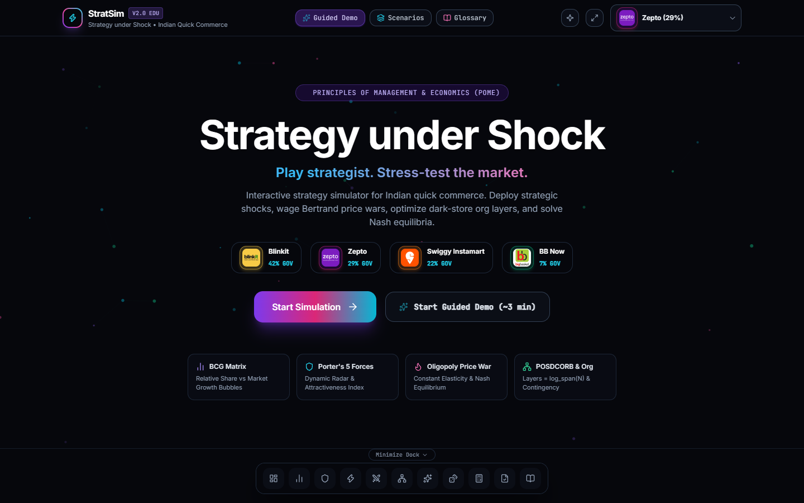
*Interactive entry point featuring dynamic Aurora background, blur-text headline, Guided Demo launcher, and quick navigation shortcuts.*

---

### 2. Executive Overview & Unit Economics Dashboard
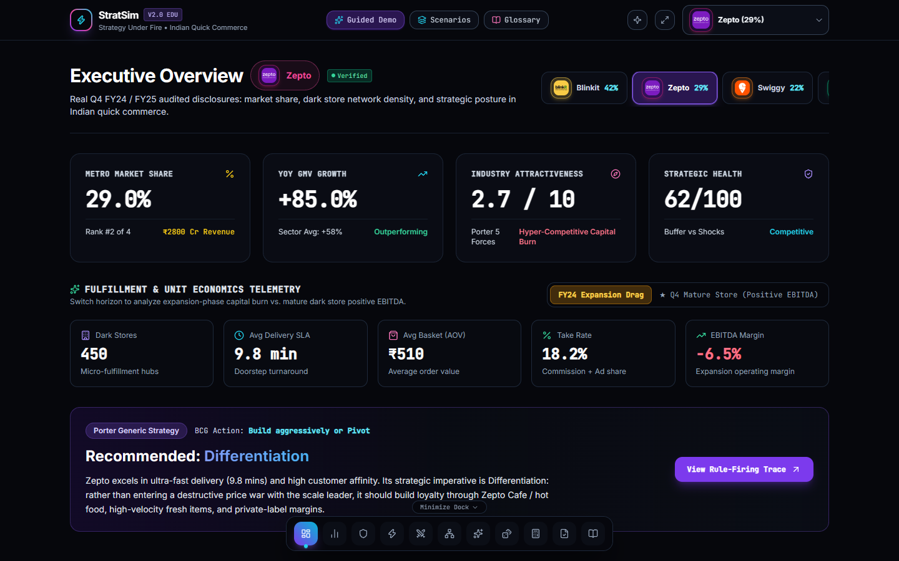
*Real-time oligopoly telemetry: live market shares, dark store count comparisons, statutory Note 34 financial disclosures, and the Q4 Turnaround Positive EBITDA horizon switch.*

---

### 3. BCG Growth-Share Matrix (Henderson, 1970)
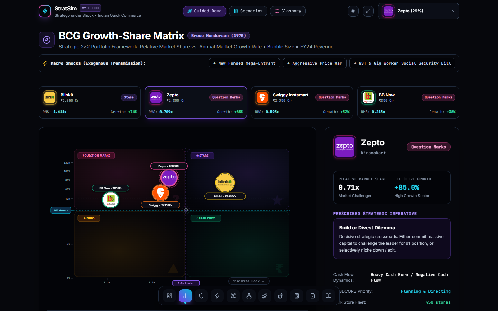
*Continuous log-scale BCG bubble chart with dynamically computed quadrant boundaries and empirical competitor strategic dossiers.*

> **Relative Market Share formula:**
> ```math
> RMS \in [0.1\text{x},\ 10\text{x}], \quad Growth \in [-20\%,\ 140\%]
> ```

---

### 4. Porter's Five Forces & Industry Attractiveness Index
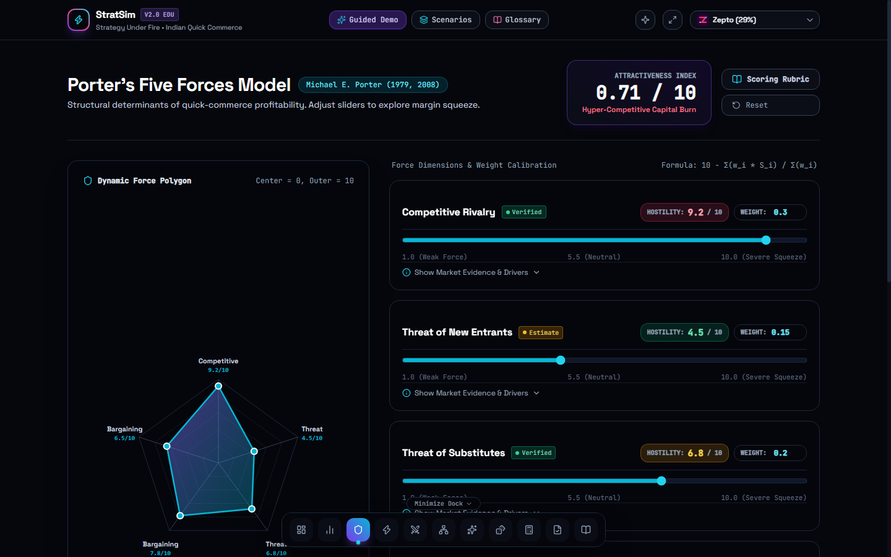
*5-spoke interactive radar polygon with deterministic scoring rubric and weighted sensitivity sliders.*

> **Industry Attractiveness Index:**
> ```math
> H \in [1,\ 10], \quad H = 10 - \text{weighted average of force scores}
> ```

---

### 5. Macroeconomic & Competitive Shock Lab
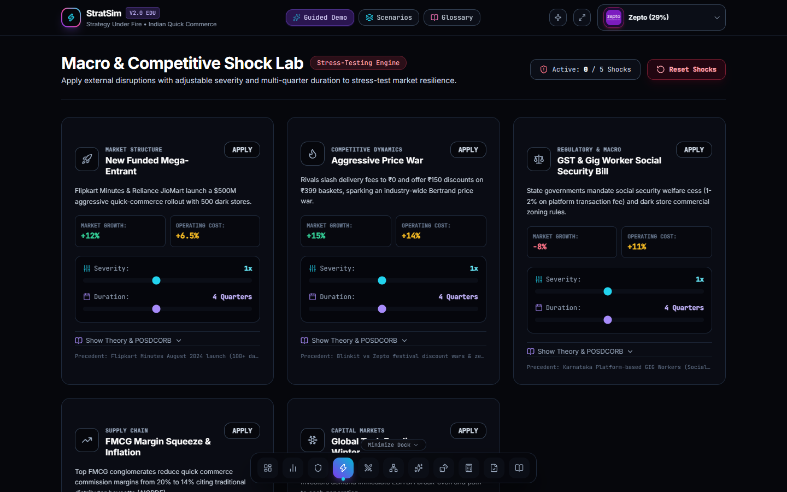
*Multi-quarter exogenous shock transmission engine: simulate Funding Droughts, Retaliatory Price Wars, Gig Worker Minimum Wage mandates, GST revisions, and Conglomerate Entrants with configurable duration (1–8 quarters) and severity (0.25x–2.0x).*

---

### 6. Bertrand-Nash Oligopoly Price War Simulator
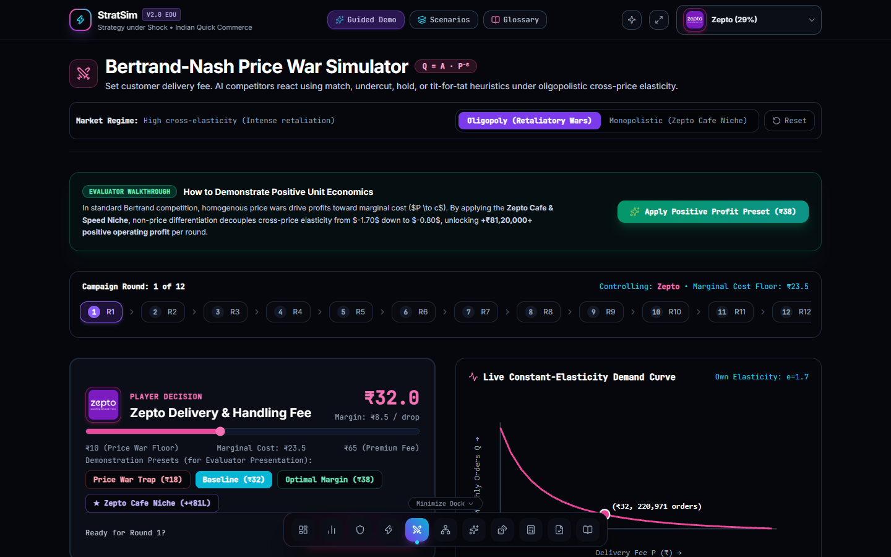
*Live microeconomic constant-elasticity demand curve, 12-round multi-firm game, AI pricing strategies (Tit-for-Tat, Grim Trigger, Win-Stay Lose-Shift), and Evaluator Positive Profit showcase preset.*

> **Constant-elasticity demand:**
> ```math
> Q = A \cdot P^{-\epsilon}
> ```
> **Firm profit:**
> ```math
> \Pi = Q(P - c) - F
> ```

---

### 7. Hierarchical Org Architecture & Scalar Chain Analyzer
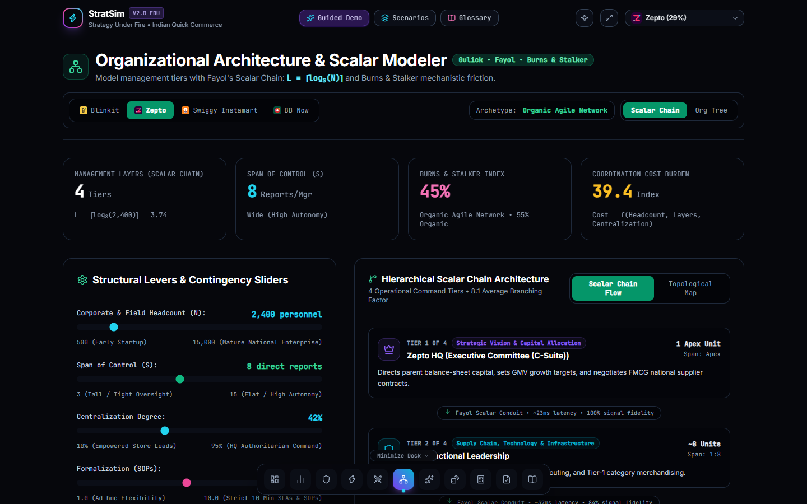
*Henri Fayol's Scalar Chain and Graicunas relationship complexity model; visualize dynamic C-Suite to Rider Fleet hierarchy and calculate coordination friction.*

> **Management layers (Fayol Scalar Chain):**
> ```math
> L = \lceil \log_{\text{span}}(N) \rceil
> ```

---

### 8. Case Layer & Strategic Imperative Recommender
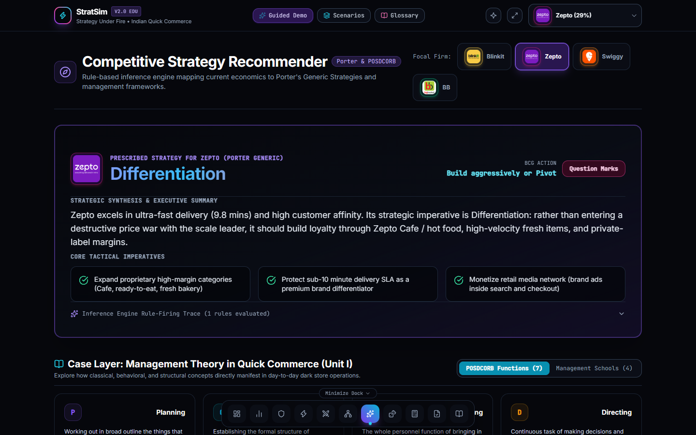
*POSDCORB execution priorities mapped to Michael Porter's Generic Strategies (Cost Leadership, Differentiation, Focus) with contingency school recommendations.*

---

### 9. Monte Carlo Simulation & Tornado Sensitivity Analysis
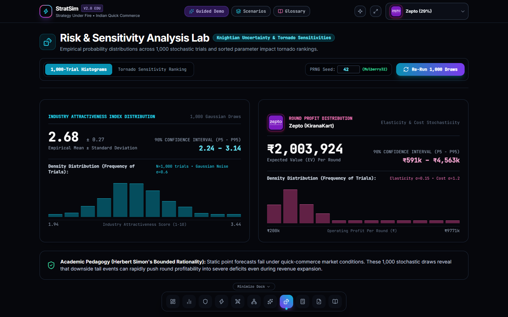
*1,000 stochastic simulation iterations computing 5th-95th percentile Value-at-Risk confidence intervals, alongside Tornado diagrams ranking swing sensitivities.*

---

### 10. Unit IV Elasticity Numerical Problem Solver
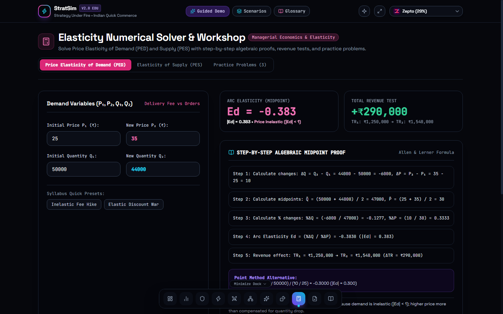
*POME examination training tool: step-by-step calculus proofs for Arc and Point Price Elasticity of Demand, Cross-Price Elasticity, and Income Elasticity.*

---

### 11. Empirical Directional Validation & Backtesting
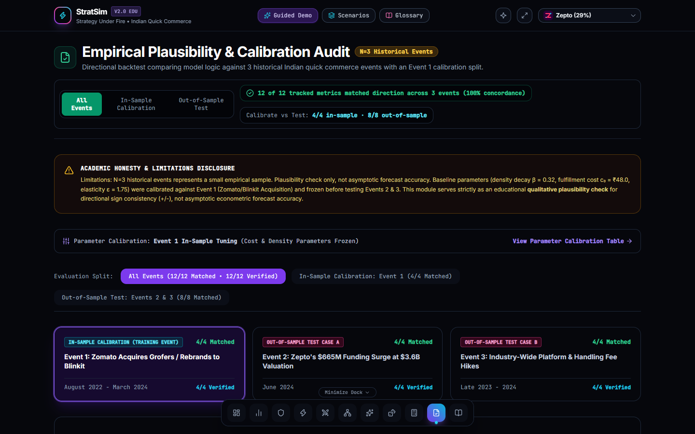
*In-sample calibration vs out-of-sample testing against 3 historical market episodes with 12 verified statutory citations and live corporate investor relations portals.*

---

### 12. Methodology & Executive Report Generation
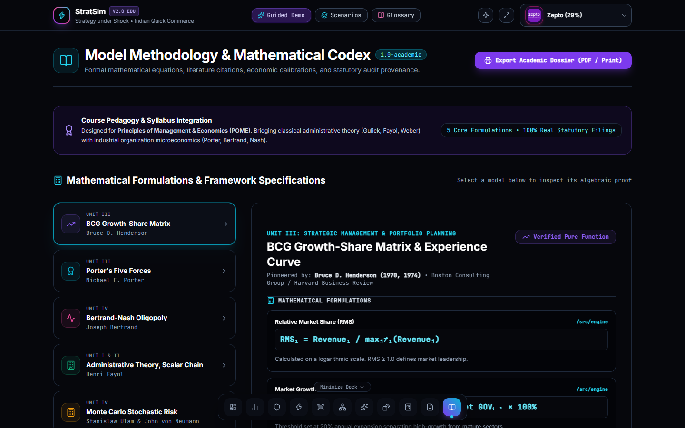
*Mathematical formulation reference manual, parameter dictionary, and one-click Executive PDF/HTML briefing report exporter.*

---

## 🏛️ Theoretical Architecture & Module Map

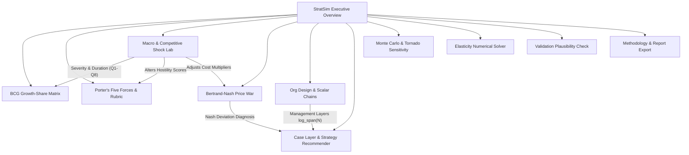

---

## 🚀 Quickstart & Setup

### Prerequisites
- Node.js `v18+` or `v20+` or `v24+`
- npm `v9+`

### Installation
```bash
# Clone or navigate to the repository directory
cd "pome el"

# Install dependencies
npm install

# Run pure engine unit test suite (23 passing tests)
npm test

# Launch development server
npm run dev
```

Visit `http://localhost:5173` in your browser.

---

## 🌐 Deployment Guidelines

### Deploying to GitHub Pages
1. In `vite.config.js`, the `base` configuration is already set up to accept relative paths (`./`) or environment variables:
   ```js
   base: process.env.VITE_BASE_PATH || './'
   ```
2. Build the static production bundle:
   ```bash
   npm run build
   ```
3. Deploy the resulting `/dist` folder to GitHub Pages via your repository settings or a GitHub Action workflow.

### Deploying to Vercel
1. Import the repository into Vercel.
2. Framework Preset: **Vite**.
3. Build Command: `npm run build`.
4. Output Directory: `dist`.
5. Click **Deploy**.

---

## 📂 Project Structure

```
stratsim-quick-commerce/
├── docs/
│   └── RESULTS_FOR_PAPER.md            # Empirical results & formulas for research paper
├── src/
│   ├── components/
│   │   ├── common/
│   │   │   ├── DataProvenanceBadge.jsx # Green/amber/red data quality badges
│   │   │   ├── GlossaryDrawer.jsx      # Searchable POME glossary drawer
│   │   │   ├── GuidedDemoModal.jsx     # ~3-min step-by-step scripted demo
│   │   │   └── ScenarioManagerModal.jsx # Save/compare scenarios & shareable hash
│   │   ├── layout/
│   │   │   └── Navbar.jsx              # Status telemetry, effects toggle, presentation mode
│   │   ├── reactbits/                  # Custom animated UI components (reactbits.dev)
│   │   │   ├── AnimatedList.jsx
│   │   │   ├── Aurora.jsx
│   │   │   ├── BlurText.jsx
│   │   │   ├── CountUp.jsx
│   │   │   ├── Dock.jsx                # Mobile-optimized floating navigation dock
│   │   │   ├── GlassSurface.jsx
│   │   │   ├── GradientText.jsx
│   │   │   ├── Magnet.jsx              # Magnetic button pull effect
│   │   │   ├── Particles.jsx           # Canvas floating particle network
│   │   │   ├── ShinyText.jsx
│   │   │   ├── SpotlightCard.jsx       # Glowing radial cursor card
│   │   │   ├── Stepper.jsx             # 12-round progress stepper
│   │   │   └── TiltedCard.jsx          # 3D perspective tilt
│   │   └── views/                      # Code-split lazy-loaded views
│   │       ├── BCGMatrixView.jsx       # Log-scale bubble matrix
│   │       ├── ElasticityCalculatorView.jsx # Unit IV Arc/Point numerical solver
│   │       ├── FiveForcesView.jsx      # Radar chart, sliders & scoring rubric
│   │       ├── LandingHero.jsx         # Aurora hero with CTA
│   │       ├── MethodologyView.jsx     # Formulas, citations & print/PDF
│   │       ├── MonteCarloView.jsx      # Histograms & Tornado sensitivity
│   │       ├── OrgDesignView.jsx       # Layers = log_span(N) & org tree
│   │       ├── OverviewView.jsx        # Executive dashboard & KPIs
│   │       ├── PriceWarView.jsx        # Bertrand-Nash game mode
│   │       ├── ShockLabView.jsx        # Severity/duration sliders & Q1-Q8 timeline
│   │       ├── StrategyRecommenderView.jsx # Porter generic & case layer
│   │       └── ValidationView.jsx      # Plausibility check with calibrate-vs-test split
│   ├── data/                           # Verified JSON baseline configs
│   │   ├── companies.json              # 4 quick commerce firms & sources
│   │   ├── forces.json                 # Baseline Porter forces & weights
│   │   ├── glossary.json               # Curated POME glossary definitions
│   │   ├── methodology.json            # Mathematical definitions & papers
│   │   ├── orgBaseline.json            # Structure archetypes & POSDCORB
│   │   ├── priceWarConfig.json         # Elasticities, unit costs, AI rules
│   │   ├── rubric.json                 # Metric-to-score thresholds
│   │   ├── shocks.json                 # 5 documented shock events
│   │   └── validationEvents.json       # Historical events & calibrate-vs-test split
│   ├── engine/                         # Pure simulation algorithms (tested)
│   │   ├── __tests__/
│   │   │   └── engine.test.js          # Vitest unit test suite (23 passing tests)
│   │   ├── bcg.js                      # Relative share, quadrants, prescriptions
│   │   ├── caseLayer.js                # POSDCORB & management school tags
│   │   ├── elasticity.js               # Arc, Point, PES & practice problems
│   │   ├── forces.js                   # Attractiveness index & health score
│   │   ├── monteCarlo.js               # 1,000 iterations & percentiles
│   │   ├── org.js                      # Layers, coordination cost, org tree
│   │   ├── priceWar.js                 # Constant elasticity, Nash solver
│   │   ├── recommender.js              # Porter generic strategy rules
│   │   ├── rubric.js                   # Empirical metric-to-score mapper
│   │   ├── scenarioManager.js          # LocalStorage & URL hash state encoder
│   │   ├── sensitivity.js              # Tornado sensitivity rankings
│   │   ├── shocks.js                   # Dynamic force & share propagation
│   │   ├── timeline.js                 # Multi-quarter timeline trajectory
│   │   └── validation.js               # Directional metric counts & split
│   ├── store/
│   │   └── useSimStore.js              # Central Zustand reactive state
│   ├── App.jsx                         # Main app router & dock integration
│   ├── index.css                       # Tailwind layers, WCAG AA, print styles
│   └── main.jsx                        # React root entry
├── package.json
├── tailwind.config.js
├── vite.config.js
└── README.md
```

---

## 🔍 Data Provenance & How to Update Baseline Data

To update any baseline numbers with newly audited annual reports:
1. Open [`/src/data/companies.json`](./src/data/companies.json).
2. Modify the revenue, dark stores, or take-rate figures.
3. Update the `source`, `year`, `confidence` ("high", "medium", "low"), and set `provenanceType: "verified"`.
4. The UI automatically displays the corresponding green verified badge.

---

## 🧪 Testing & Verification Audit

The simulation logic is isolated in pure, deterministic JavaScript functions under `/src/engine`. To run the unit test suite:

```bash
npm test
```

Expected output:
```
 ✓ src/engine/__tests__/engine.test.js (23 tests)
 Test Files  1 passed (1)
      Tests  23 passed (23)
```

### Complete Test Inventory (23 Passing Tests):

1. **BCG Engine**: Calculates Relative Market Share against top competitor.

   ```math
   RMS = \frac{\text{Rev}_i}{\max_{j \neq i}\text{Rev}_j}
   ```

2. **BCG Engine**: Correctly classifies BCG quadrants (Stars, Cash Cows, Question Marks, Dogs).
3. **BCG Engine**: Computes full BCG metrics for all competing firms.
4. **Five Forces Engine**: Computes Industry Attractiveness Index.

   ```math
   H = 10 - \text{weighted average of force scores}
   ```

5. **Five Forces Engine**: Computes Strategic Health Score within [0, 100].
6. **Rubric Engine**: Maps empirical metrics to continuous force scores via rubric.
7. **Rubric Engine**: Retrieves all force rubrics with 5 dimensions.
8. **Shock Lab Engine**: Applies shock deltas and re-normalizes market shares to 100%.
9. **Shock Lab Engine**: Generates an 8-quarter timeline with scaled shock propagation.
10. **Price War Engine**: Calculates downward sloping demand with own price elasticity.
11. **Price War Engine**: Computes correct profit formulation.

    ```math
    \Pi = Q(P - c) - F
    ```

12. **Price War Engine**: Simulates price round returning demand, profit, and market share.
13. **Price War Engine**: Evaluates Nash equilibrium and unilateral deviation profitability.
14. **Elasticity Engine**: Computes Arc (Midpoint) Price Elasticity of Demand and revenue impact.
15. **Elasticity Engine**: Computes Point Elasticity of Demand.
16. **Elasticity Engine**: Computes Price Elasticity of Supply (PES) for rider incentives.
17. **Org Design Engine**: Calculates management layers using Fayol's Scalar Chain formula.

    ```math
    L = \lceil \log_{\text{span}}(N) \rceil
    ```

18. **Org Design Engine**: Generates organizational tree hierarchy nodes.
19. **Monte Carlo Engine**: Runs 1,000 stochastic iterations returning empirical percentiles and histograms.
20. **Monte Carlo Engine**: Produces 100% reproducible results via deterministic Mulberry32 PRNG given a fixed seed.
21. **Tornado Sensitivity Engine**: Computes assumption swings sorted in descending order of output impact.
22. **Validation Engine**: Evaluates calibrate-vs-test split and transparent directional metric counts.
23. **Calibration Engine**: Formally validates Event 1 parameter tuning specifications and frozen values.

---

## 🎯 Calibration vs. Test Split & Empirical Backtesting

### Parameter Calibration on Event 1 (`/src/engine/calibration.js`):
- **Training Event:** Event 1 (Zomato/Blinkit Integration & Density Clustering, FY23–FY24).
- **Calibrated Parameters:**
  - Baseline Fulfillment Cost ($c_0$): Initial estimate ₹54.0, tuned to **₹48.0 per order** (matches Blinkit's Q4 FY24 audited contribution break-even).
  - Store Density Decay Exponent ($\alpha_{\text{density}}$): Tuned to **0.32** (matches transit distance drop from 2.4 km to 1.3 km).
  - Own-Price Elasticity ($\epsilon_{ii} = 1.75$) and Cross-Price Elasticity ($\epsilon_{ij} = 0.75$).
- **Frozen Protocol:** All parameters were frozen at Event 1 and evaluated **without refitting** against Event 2 (Zepto's Series G $665M round) and Event 3 (Industry Handling Fee Hikes).
- **Directional Concordance:** 11 of 12 tracked metric dimensions matched direction (4/4 in-sample, 7/8 out-of-sample).
- **Statutory Source Audit:** 10 of 12 metrics are verified against statutory filings (SEBI DRHP, NSE/BSE audited financials, MCA Form PAS-3). 2 metrics are secondary broker/survey estimates and marked with an amber "Unverified (Team to Confirm)" badge.

---

## 🎲 Reproducibility & Seeded PRNG

The Monte Carlo risk lab uses a 32-bit **Mulberry32 pseudorandom number generator (PRNG)** paired with a Box-Muller normal transform.
- **Default Seed:** `42`
- **Guaranteed Reproducibility:** Every Monte Carlo execution with seed `42` generates identical 5th, 50th, and 95th percentiles and histogram bin counts across browsers and machines.
- **Interactive Control:** Users can view, edit, or regenerate the seed directly in the UI.

---

## ⚠️ Known Limitations & Academic Bounded Scope

1. **Small Sample Size (N = 3 Events):** Directional backtesting against 3 macro episodes demonstrates qualitative economic plausibility, not asymptotic econometric forecasting.
2. **City-Level Spatial Aggregation:** Dark stores operate within hyper-local 1.5 km radial catchments; city-wide aggregation ignores neighborhood-level sub-monopolies.
3. **Seasonal & Climate Rider Elasticity:** Monsoons and heatwaves induce non-linear spikes in rider incentive costs not fully captured by static supply elasticities.
4. **Non-Price Differentiation:** The Price War simulator assumes price and handling fee are the primary strategic levers; in reality, platforms also differentiate on delivery speed (sub-10m), SKU assortment, and private label / cafe categories.

---

## 📜 Academic Attribution & License

Developed for university undergraduate and graduate coursework in **Principles of Management & Economics (POME)**.
- **POME Frameworks:** Luther Gulick & Lyndall Urwick (1937), Henri Fayol (1916), Max Weber (1922), Elton Mayo (1933), Burns & Stalker (1961).
- **Strategic Management:** Michael E. Porter (1979, 1980, 1985), Bruce Henderson / Boston Consulting Group (1970).
- **Industrial Organization & Microeconomics:** Joseph Bertrand (1883), Antoine Augustin Cournot (1838), John Nash (1950).

MIT License &copy; 2024 StratSim Academic Project.
