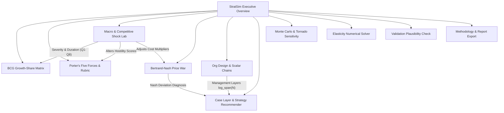

# StratSim: Strategy Under Fire (v2.0)
> **Interactive Quick Commerce Strategy Simulator & Economic Stress-Testing Lab**  
> Designed for *Principles of Management & Economics (POME)* | College Core Curriculum


---

## 📖 Overview

**StratSim: Strategy Under Fire** is an interactive, fully client-side strategy simulator modeling the fierce oligopolistic battle for India's 10-minute grocery delivery market between **Blinkit (Zomato)**, **Zepto**, **Swiggy Instamart**, and **BigBasket Now (Tata)**. 

Built to teach core concepts in **Principles of Management & Economics (POME)**, the platform connects classical and modern management frameworks with microeconomic pricing mechanics:
1. **BCG Growth-Share Matrix** (Henderson, 1970) with dynamic shock shifts.
2. **Porter's Five Forces & Industry Attractiveness Index** (Porter, 1979, 2008) with deterministic scoring rubric.
3. **Michael Porter's Generic Competitive Strategies** (Cost Leadership, Differentiation, Focus).
4. **Bertrand-Nash Oligopoly Price War** with constant elasticity of demand ($Q = A \cdot P^{-\epsilon}$).
5. **Luther Gulick's POSDCORB** (Planning, Organizing, Staffing, Directing, Coordinating, Reporting, Budgeting).
6. **Organizational Architecture & Scalar Chains** ($L = \lceil \log_{\text{span}}(N) \rceil$).
7. **Classical, Behavioral, Systems, and Contingency Management Schools**.
8. **Monte Carlo Risk Uncertainty** (1,000 stochastic runs with 5th-95th percentile bounds).
9. **Tornado Sensitivity Analysis** ranking assumption impact on profit and attractiveness.
10. **Multi-Quarter Shock Timeline** with configurable severity (0.25x–2.0x) and duration (1–8 quarters).
11. **Unit IV Elasticity Problem Solver** for Arc/Point demand & supply numericals with step-by-step proofs.
12. **Directional Plausibility Backtesting** with an in-sample calibration vs out-of-sample test split.
13. **Guided Interactive Walkthrough (~3 min)** and **Searchable POME Glossary Drawer**.

---

## 📸 Screenshots & UI Layout

| Module | Preview / Placeholder | Core Analytical Function |
| :--- | :--- | :--- |
| **Hero Landing & Aurora Canvas** | `[Screenshot: Hero Landing with BlurText & Magnet CTA]` | Interactive entry point and Guided Demo launcher |
| **Executive Overview Dashboard** | `[Screenshot: Spotlight Cards & Unit Economics]` | Market shares, growth rates, dark store counts |
| **BCG Growth-Share Matrix** | `[Screenshot: Log-Scale BCG Bubble Chart]` | Relative Market Share vs Market Growth Rate |
| **Five Forces Radar & Rubric** | `[Screenshot: 5-Spoke Polygon & Scoring Rubric]` | Industry Attractiveness Index calculation |
| **Bertrand Price War & Demand Curve** | `[Screenshot: Live Q(P) Demand Curve & Nash Status]` | Multi-firm pricing, AI strategies, 12-round game |
| **Tornado Sensitivity & Monte Carlo** | `[Screenshot: Density Histogram & Tornado Chart]` | 1,000 stochastic runs & parameter impact ranking |
| **Elasticity Numerical Problem Solver**| `[Screenshot: Step-by-Step Arc & Point Proofs]` | POME Unit IV textbook exam practice problem solver |
| **Hierarchical Org Tree Visualizer** | `[Screenshot: Dynamic C-Suite to Rider Fleet Tree]` | $L = \lceil \log_{\text{span}}(N) \rceil$ and coordination index |

---

## 🏛️ Theoretical Architecture & Module Map



---

## 🚀 Quickstart & Setup

### Prerequisites
- Node.js `v18+` or `v20+` or `v24+`
- npm `v9+`

### Installation
```bash
# Clone or navigate to the repository directory
cd "pome el"

# Install dependencies
npm install

# Run pure engine unit test suite (12 passing tests)
npm test

# Launch development server
npm run dev
```

Visit `http://localhost:5173` in your browser.

---

## 🌐 Deployment Guidelines

### Deploying to GitHub Pages
1. In `vite.config.js`, the `base` configuration is already set up to accept relative paths (`./`) or environment variables:
   ```js
   base: process.env.VITE_BASE_PATH || './'
   ```
2. Build the static production bundle:
   ```bash
   npm run build
   ```
3. Deploy the resulting `/dist` folder to GitHub Pages via your repository settings or a GitHub Action workflow.

### Deploying to Vercel
1. Import the repository into Vercel.
2. Framework Preset: **Vite**.
3. Build Command: `npm run build`.
4. Output Directory: `dist`.
5. Click **Deploy**.

---

## 📂 Project Structure

```
stratsim-quick-commerce/
├── docs/
│   └── RESULTS_FOR_PAPER.md            # Empirical results & formulas for research paper
├── src/
│   ├── components/
│   │   ├── common/
│   │   │   ├── DataProvenanceBadge.jsx # Green/amber/red data quality badges
│   │   │   ├── GlossaryDrawer.jsx      # Searchable POME glossary drawer
│   │   │   ├── GuidedDemoModal.jsx     # ~3-min step-by-step scripted demo
│   │   │   └── ScenarioManagerModal.jsx # Save/compare scenarios & shareable hash
│   │   ├── layout/
│   │   │   └── Navbar.jsx              # Status telemetry, effects toggle, presentation mode
│   │   ├── reactbits/                  # Custom animated UI components (reactbits.dev)
│   │   │   ├── AnimatedList.jsx
│   │   │   ├── Aurora.jsx
│   │   │   ├── BlurText.jsx
│   │   │   ├── CountUp.jsx
│   │   │   ├── Dock.jsx                # Mobile-optimized floating navigation dock
│   │   │   ├── GlassSurface.jsx
│   │   │   ├── GradientText.jsx
│   │   │   ├── Magnet.jsx              # Magnetic button pull effect
│   │   │   ├── Particles.jsx           # Canvas floating particle network
│   │   │   ├── ShinyText.jsx
│   │   │   ├── SpotlightCard.jsx       # Glowing radial cursor card
│   │   │   ├── Stepper.jsx             # 12-round progress stepper
│   │   │   └── TiltedCard.jsx          # 3D perspective tilt
│   │   └── views/                      # Code-split lazy-loaded views
│   │       ├── BCGMatrixView.jsx       # Log-scale bubble matrix
│   │       ├── ElasticityCalculatorView.jsx # Unit IV Arc/Point numerical solver
│   │       ├── FiveForcesView.jsx      # Radar chart, sliders & scoring rubric
│   │       ├── LandingHero.jsx         # Aurora hero with CTA
│   │       ├── MethodologyView.jsx     # Formulas, citations & print/PDF
│   │       ├── MonteCarloView.jsx      # Histograms & Tornado sensitivity
│   │       ├── OrgDesignView.jsx       # Layers = log_span(N) & org tree
│   │       ├── OverviewView.jsx        # Executive dashboard & KPIs
│   │       ├── PriceWarView.jsx        # Bertrand-Nash game mode
│   │       ├── ShockLabView.jsx        # Severity/duration sliders & Q1-Q8 timeline
│   │       ├── StrategyRecommenderView.jsx # Porter generic & case layer
│   │       └── ValidationView.jsx      # Plausibility check with calibrate-vs-test split
│   ├── data/                           # Verified JSON baseline configs
│   │   ├── companies.json              # 4 quick commerce firms & sources
│   │   ├── forces.json                 # Baseline Porter forces & weights
│   │   ├── glossary.json               # Curated POME glossary definitions
│   │   ├── methodology.json            # Mathematical definitions & papers
│   │   ├── orgBaseline.json            # Structure archetypes & POSDCORB
│   │   ├── priceWarConfig.json         # Elasticities, unit costs, AI rules
│   │   ├── rubric.json                 # Metric-to-score thresholds
│   │   ├── shocks.json                 # 5 documented shock events
│   │   └── validationEvents.json       # Historical events & calibrate-vs-test split
│   ├── engine/                         # Pure simulation algorithms (tested)
│   │   ├── __tests__/
│   │   │   └── engine.test.js          # Vitest unit test suite (12 passing tests)
│   │   ├── bcg.js                      # Relative share, quadrants, prescriptions
│   │   ├── caseLayer.js                # POSDCORB & management school tags
│   │   ├── elasticity.js               # Arc, Point, PES & practice problems
│   │   ├── forces.js                   # Attractiveness index & health score
│   │   ├── monteCarlo.js               # 1,000 iterations & percentiles
│   │   ├── org.js                      # Layers, coordination cost, org tree
│   │   ├── priceWar.js                 # Constant elasticity, Nash solver
│   │   ├── recommender.js              # Porter generic strategy rules
│   │   ├── rubric.js                   # Empirical metric-to-score mapper
│   │   ├── scenarioManager.js          # LocalStorage & URL hash state encoder
│   │   ├── sensitivity.js              # Tornado sensitivity rankings
│   │   ├── shocks.js                   # Dynamic force & share propagation
│   │   ├── timeline.js                 # Multi-quarter timeline trajectory
│   │   └── validation.js               # Directional metric counts & split
│   ├── store/
│   │   └── useSimStore.js              # Central Zustand reactive state
│   ├── App.jsx                         # Main app router & dock integration
│   ├── index.css                       # Tailwind layers, WCAG AA, print styles
│   └── main.jsx                        # React root entry
├── package.json
├── tailwind.config.js
├── vite.config.js
└── README.md
```

---

## 🔍 Data Provenance & How to Update Baseline Data

To update any baseline numbers with newly audited annual reports:
1. Open [`/src/data/companies.json`](file:///c:/GitHub/pome%20el/src/data/companies.json).
2. Modify the revenue, dark stores, or take-rate figures.
3. Update the `source`, `year`, `confidence` ("high", "medium", "low"), and set `isPlaceholder: false` and `provenanceType: "verified"`.
4. The UI automatically displays the corresponding green verified badge.

---

## 🧪 Testing

The simulation logic is isolated in pure, deterministic JavaScript functions under `/src/engine`. To run the unit tests:

```bash
npm test
```

Expected output:
```
 ✓ src/engine/__tests__/engine.test.js (12 tests)
 Test Files  1 passed (1)
      Tests  12 passed (12)
```

---

## 📜 Academic Attribution & License

Developed for university undergraduate and graduate coursework in **Principles of Management & Economics (POME)**.
- **POME Frameworks:** Luther Gulick & Lyndall Urwick (1937), Henri Fayol (1916), Max Weber (1922), Elton Mayo (1933), Burns & Stalker (1961).
- **Strategic Management:** Michael E. Porter (1979, 1980, 1985), Bruce Henderson / Boston Consulting Group (1970).
- **Industrial Organization & Microeconomics:** Joseph Bertrand (1883), Antoine Augustin Cournot (1838), John Nash (1950).

MIT License &copy; 2024 StratSim Academic Project.
